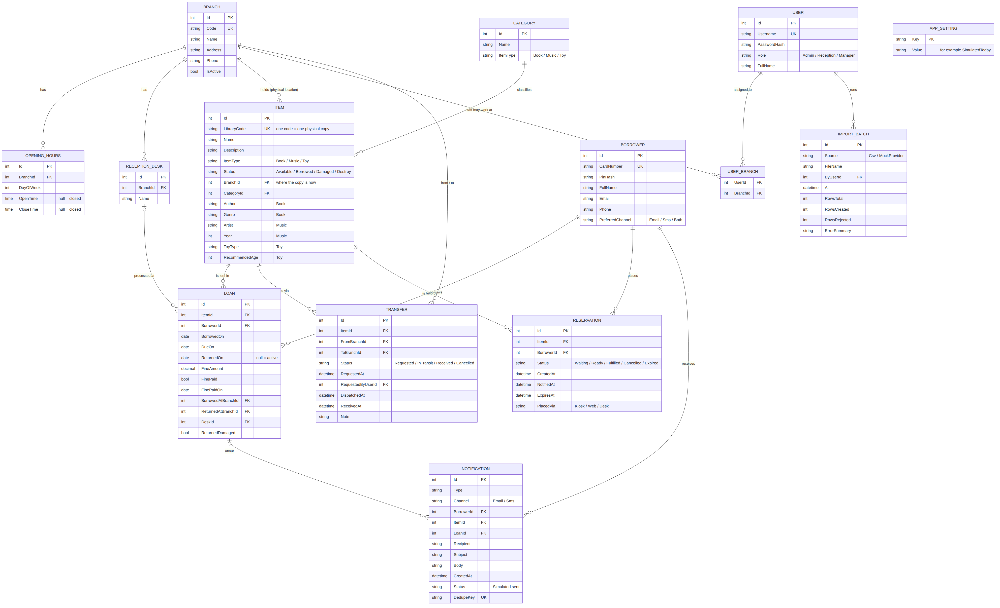
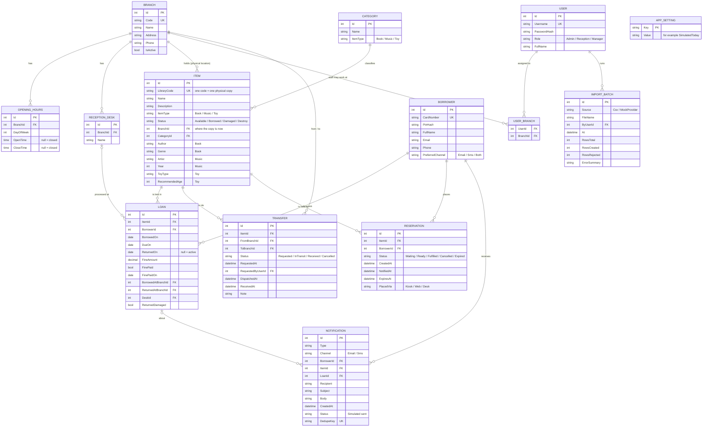

# Entity-relationship diagram (draft for Meeting 1)

The proposed data model for the platform. Items, borrowers, loans and staff users come from Assignment 2;
the other tables are new. The three item types (Book, Music, Toy) are stored in **one table** (EF Core "table per hierarchy"),
with the type-specific columns empty for the other types.

Key points to confirm at the meeting:

- `Item.BranchId` is where the copy physically is **now**. A return at another branch moves it; a transfer moves it deliberately.
- One `LibraryCode` is one physical copy (decision 4: holds are per item, not per title).
- "In transit" is not stored on the item: it is derived from an active `Transfer` (Requested or InTransit).
- `Loan.FinePaid` / `FinePaidOn` let reception mark a fine collected, so reports can show charged, collected and outstanding.
- `USER_BRANCH` says which branches a Reception user may choose after login.
- `APP_SETTING` holds the admin "simulated today" value (decision 10).
- Owners: Branch, OpeningHours, ReceptionDesk, Category, Item, Borrower, Loan, User, UserBranch, Transfer, AppSetting: **A**.
  Reservation, Notification: **B**. ImportBatch: **C**.

## Source (renders on GitHub)

