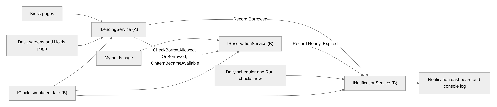
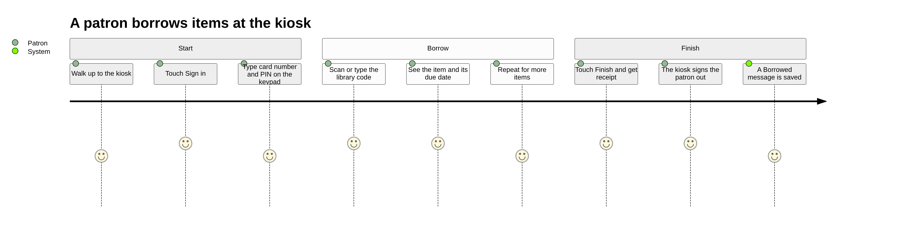
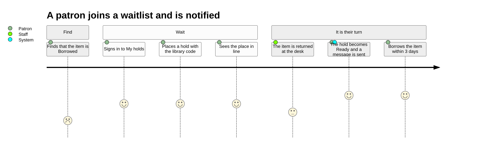
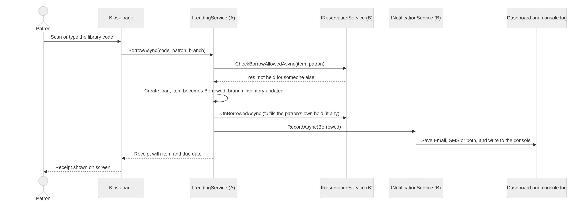
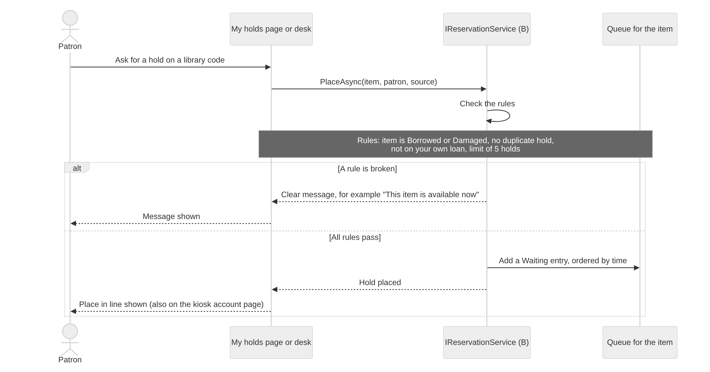
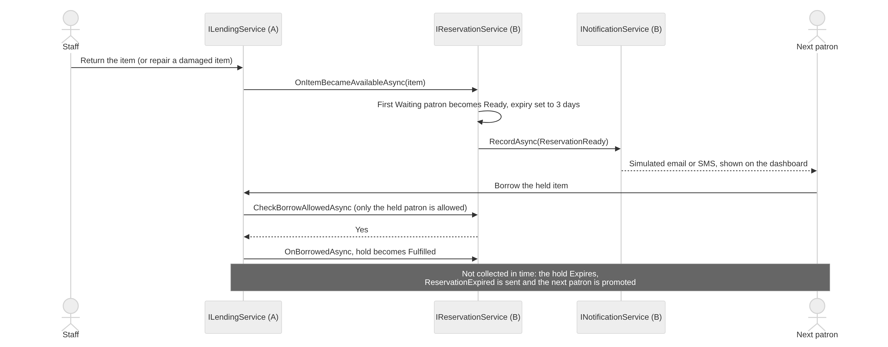

# User journeys and integration diagrams (Person B)

Inputs for the Group Portfolio. Diagram sources are in `docs/diagrams/`.

A's lending code calls B's two services (hook rule, see `docs/ARCHITECTURE.md`). Nothing else sends notifications or edits a queue.

## Journey 1: borrowing at the kiosk

The patron signs in, scans items, takes a receipt, and is signed out.

## Journey 2: joining a waitlist

The patron finds a Borrowed item, places a hold, and is told when it is Ready.

## Chain 1: borrow, inventory update, notification

A's lending asks B if the borrow is allowed, creates the loan, then tells B so B records the notification.

## Chain 2: item unavailable, join the waitlist

B checks the hold rules. If they pass, the patron joins the queue. If not, a plain message explains why.

## Chain 3: item available, next patron notified

When an item comes back or is repaired, A calls `OnItemBecameAvailableAsync`. B marks the first waiting patron Ready, sets the expiry and records a `ReservationReady` notification. Only that patron can borrow the item.

## Where to see each chain

| Chain | Where |
|---|---|
| 1 | `/kiosk` (check out), then `/notifications` |
| 2 | `/my-holds` or `/holds` (place a hold) |
| 3 | `/holds` (Return item on Dune), then `/notifications` |
