# Library Patron User Guide

This guide is for library members. It shows how to borrow at the self service kiosk, how to place a hold on an item someone else has, and how to read the messages the library sends you. The screenshots use the demo data.

## 1. Words we use

| Word | Meaning |
|---|---|
| Library card number | The number on your card. |
| PIN | Your secret 4 digit number. Never share it. |
| Library code | The code on the sticker of each item, for example `LIB-0004`. One code is one copy. |
| Branch | One library building. |
| Hold | Your place in line for an item someone else has. |
| Ready | It is your turn. The item is kept for you. |

Item status: **Available** (borrow it now), **Borrowed** (someone has it, you can place a hold), **Damaged** (being repaired, you can place a hold), **Destroyed** (gone, cannot be borrowed or held).

## 2. Finding an item and its branch

Search on the library website. Each item shows its library code, status and branch. If it is Available, go to that branch and borrow it. If it is Borrowed or Damaged, place a hold (section 4). Ask at the desk if you need help.

## 3. Borrowing at the kiosk

The kiosk is a touch screen. A barcode scanner works too, or you can type the code.

**1. Start.** Touch **Sign in**.

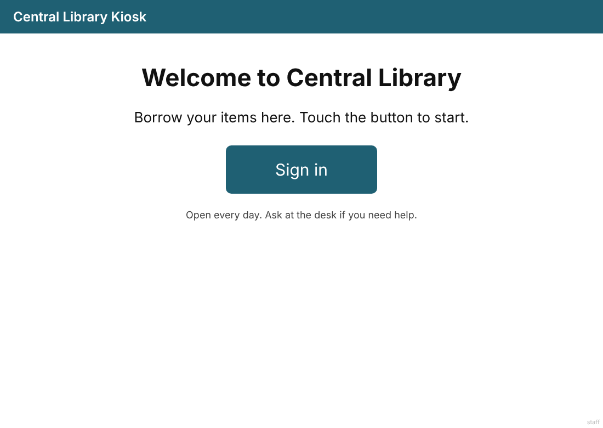

**2. Sign in.** Type your card number and PIN with the big buttons, then touch **Sign in**. Use **Back** or **Clear** to fix a mistake.

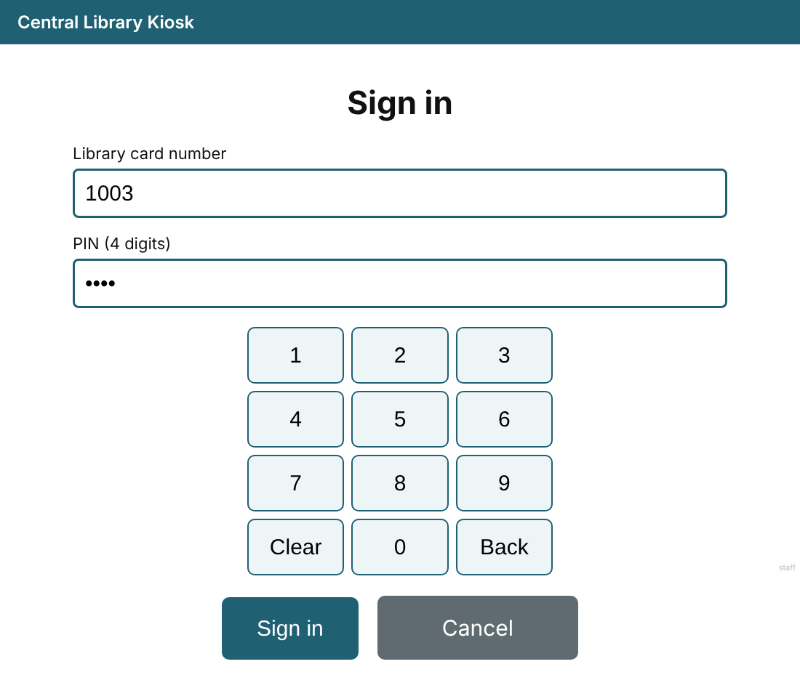

A wrong card number or PIN shows a clear message. Try again.

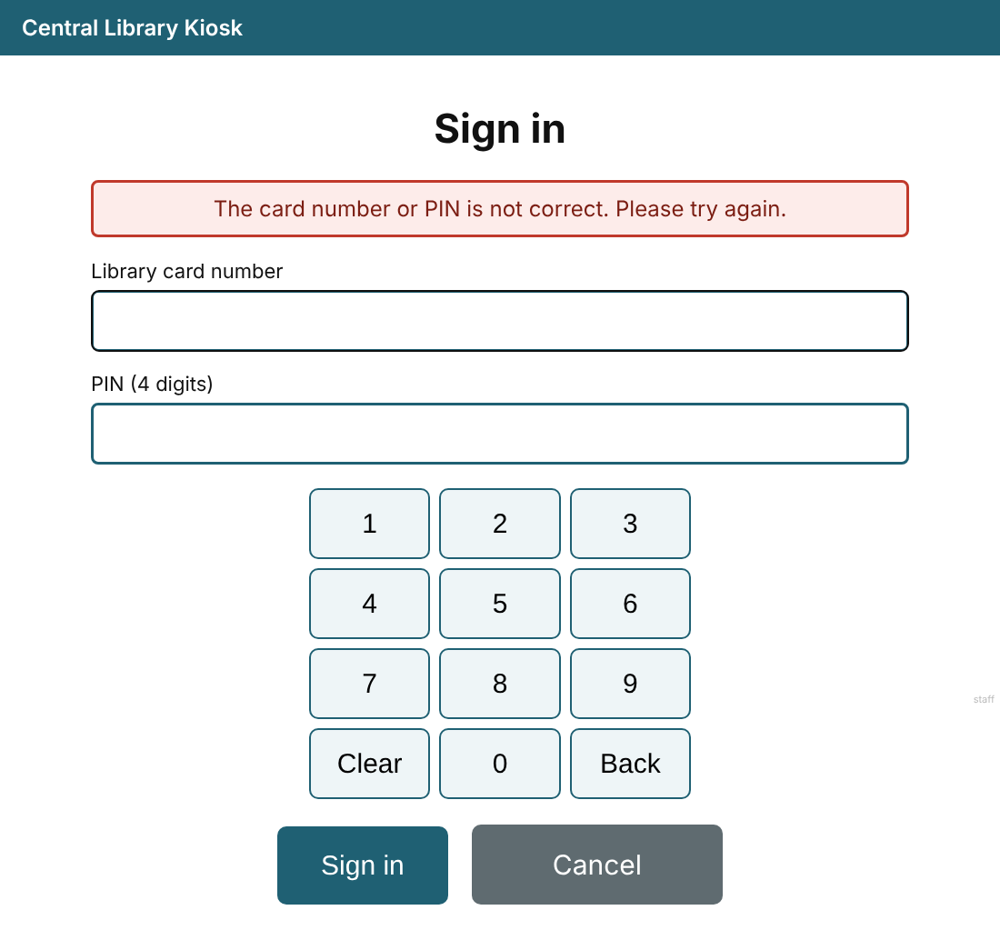

**3. Choose.** Touch **Check out items** or **My account**. **Finish** is always there.

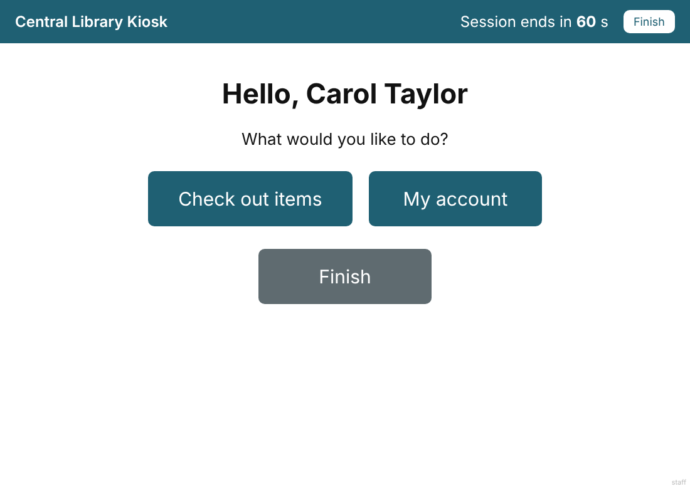

**4. Check out.** Scan or type the code, then touch **Borrow**. The item appears with its due date. Repeat for each item. You can borrow up to 12 items in one visit.

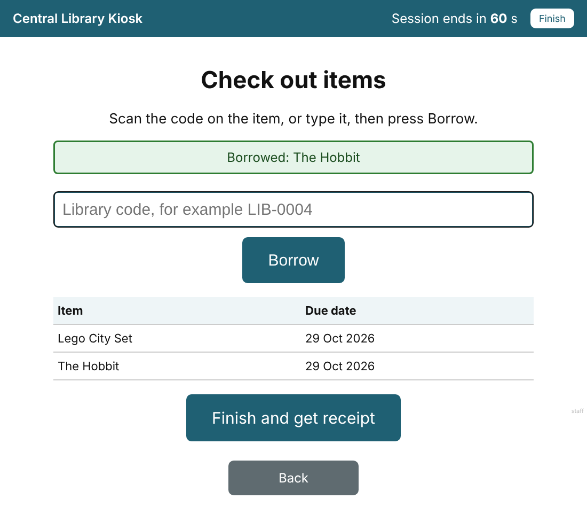

If an item cannot be borrowed, the kiosk says why (see section 7).

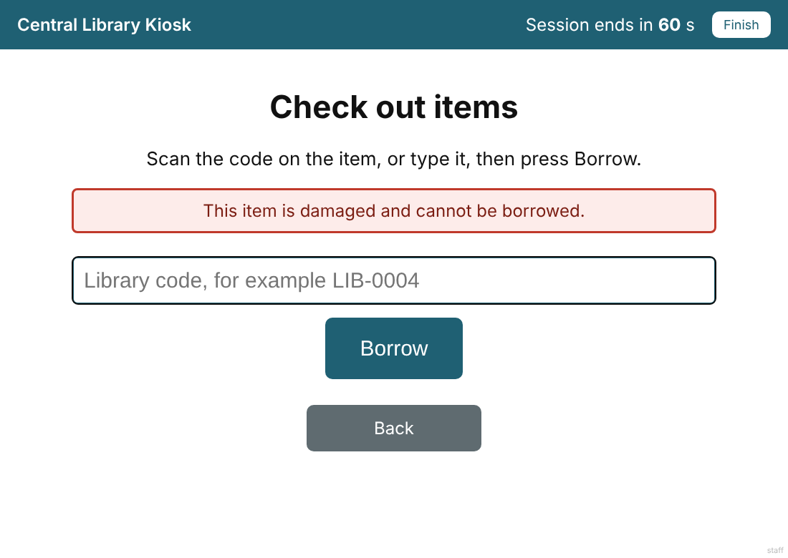

**5. Receipt.** Touch **Finish and get receipt**. It lists each item, the borrow date and the due date.

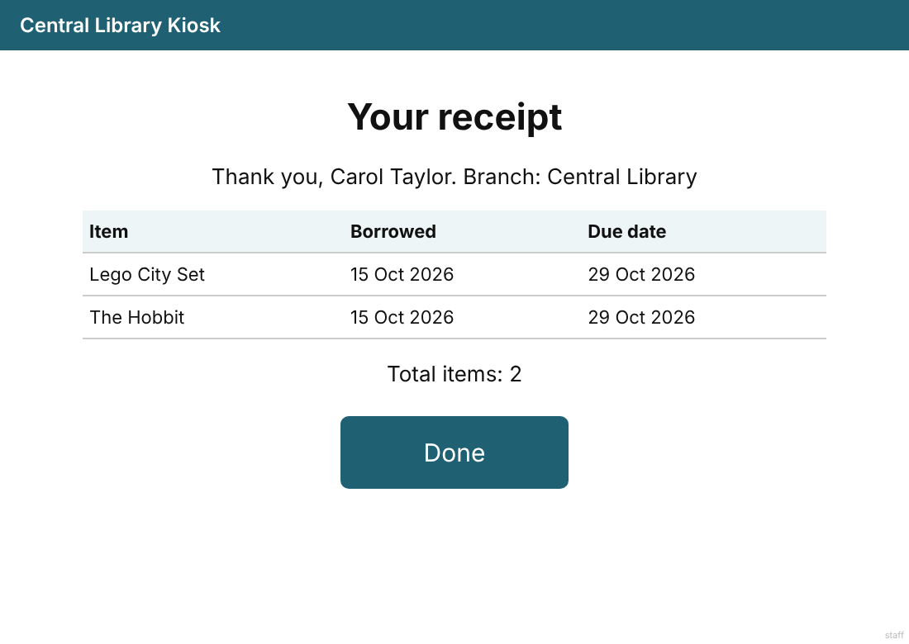

**6. Done.** Touch **Done**. The kiosk signs you out. It also signs you out after about a minute without a touch. A counter at the top shows the time left.

## 4. Placing and cancelling a hold

You can place a hold only when an item is Borrowed or Damaged. If it is Available, borrow it.

**On the website (My holds page):**

1. Open **My holds** and sign in with your card number and PIN.
2. Type the library code and touch **Place hold**.
3. Your hold shows with your place in line.
4. Touch **Cancel hold** to remove it.

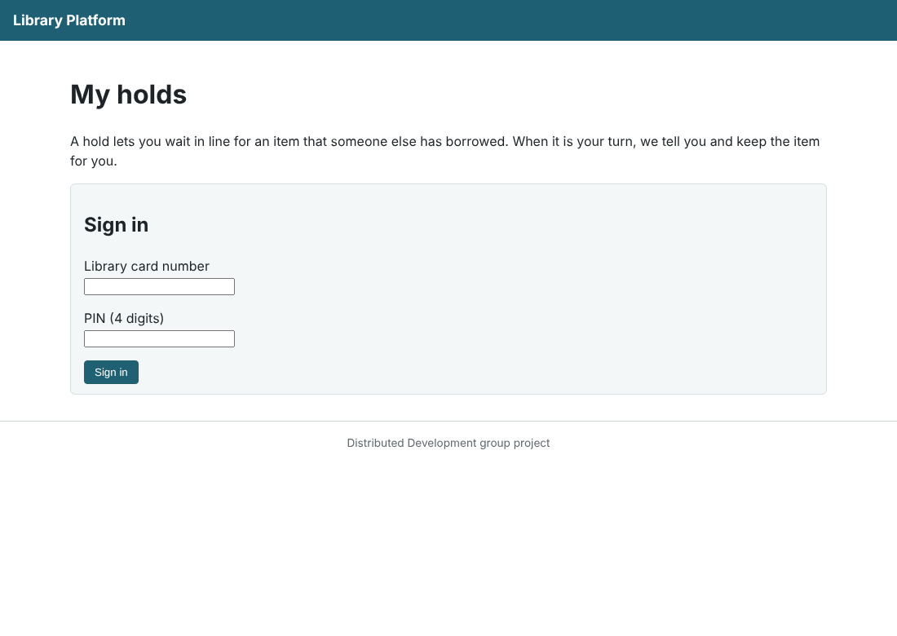

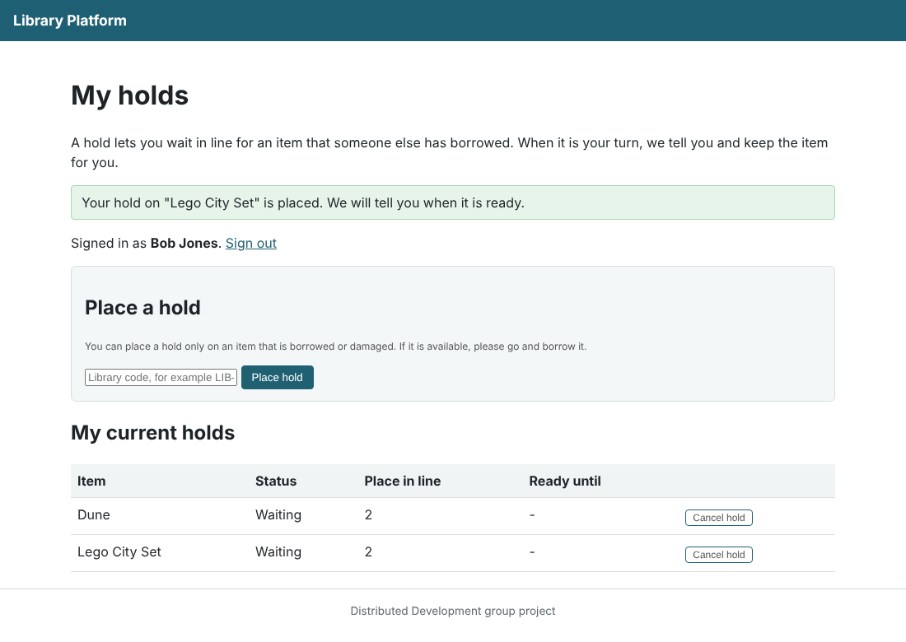

You can also ask the desk to place or cancel a hold for you.

**Rules:** one hold per item. No hold on an item you already have. Up to 5 holds at once. The line is first come, first served.

**When it is your turn:** when the item comes back, the first person in line becomes **Ready** and gets a message. The item is kept for them for 3 days. If they do not borrow it, the hold expires and the next person is told.

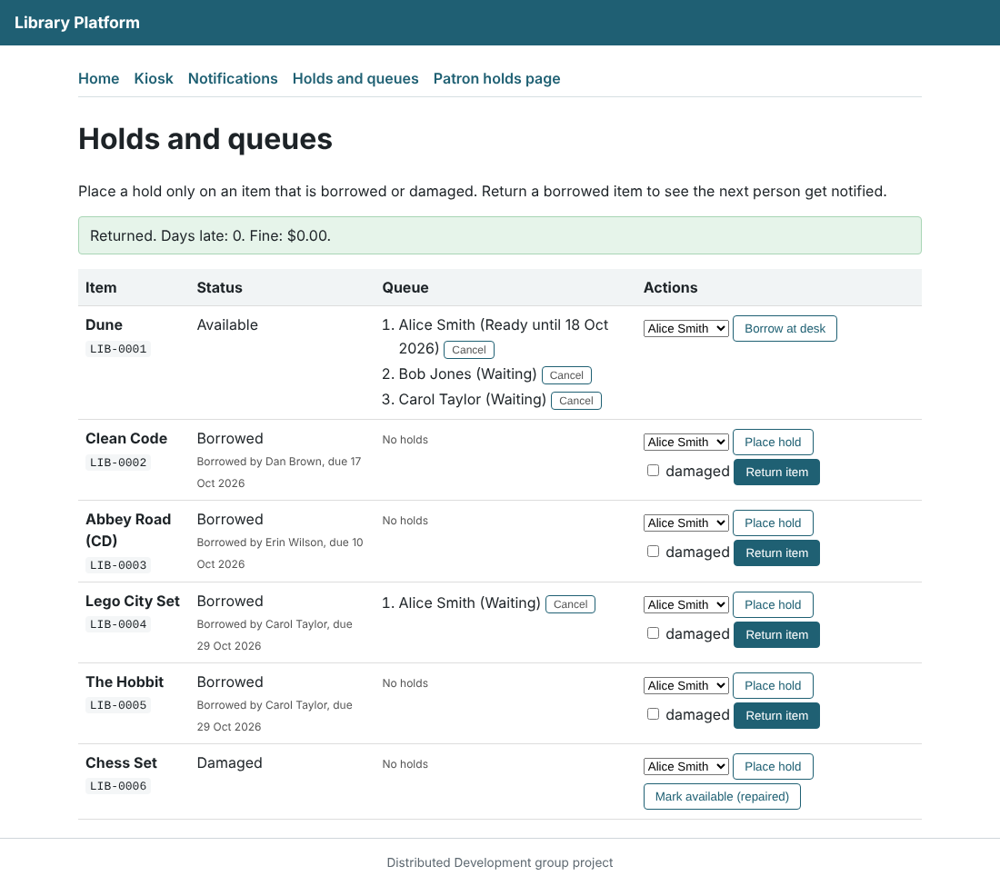

## 5. Your account at the kiosk

Sign in and touch **My account**. You see:

* **My loans:** each item, its due date and days left. Overdue items are red.
* **Fines owed:** $0.50 for each full day late.
* **My holds:** your place in line and whether an item is Ready.

You only ever see your own information.

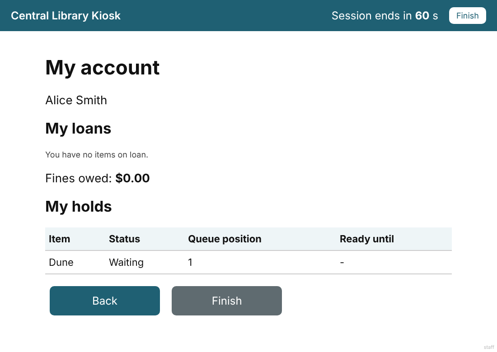

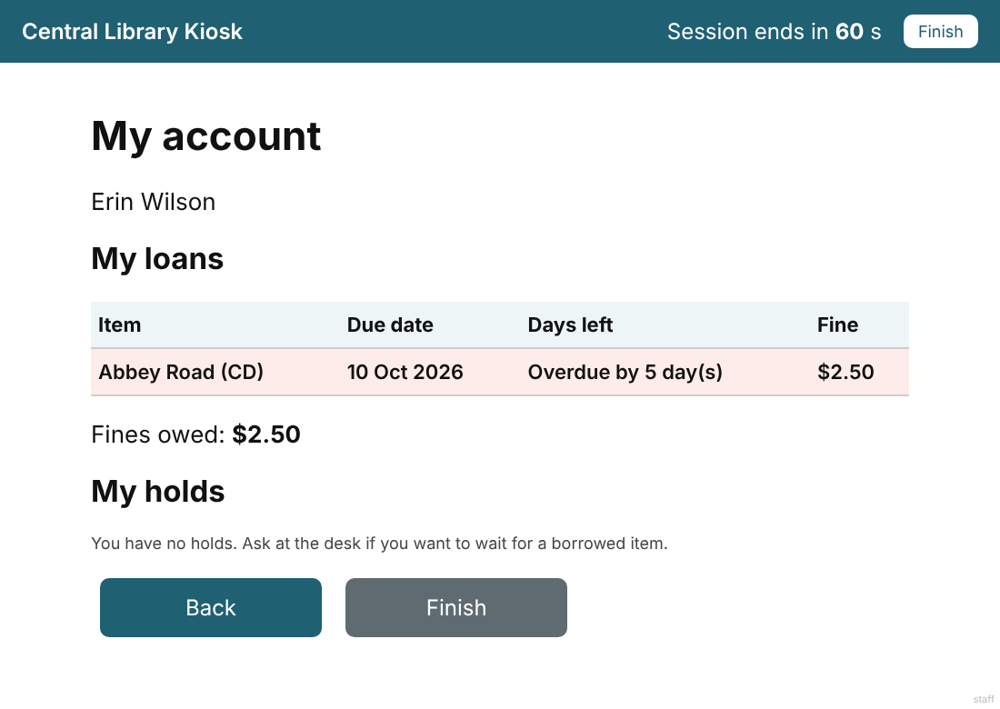

## 6. Messages from the library

You get messages by email, SMS or both, as you chose. In the demo they are not really sent. They are saved and shown on the staff Notifications page.

| Message | When | Example |
|---|---|---|
| Item borrowed | You borrow something. | Hello Carol Taylor, you borrowed "Lego City Set". It is due on 29 Oct 2026. |
| Due soon | 2 days before the due date. | "Clean Code" is due on 17 Oct 2026. Please return it on time. |
| Fine accruing | Each day an item is late. | "Abbey Road (CD)" is 5 day(s) late. The fine is now $2.50. |
| Hold ready | It is your turn. | "Dune" is ready for you. Please borrow it within 3 days. |
| Hold expired | You did not borrow in time. | Your hold on "Dune" has expired. |

Messages never show your PIN or card number. You never get the same message twice.

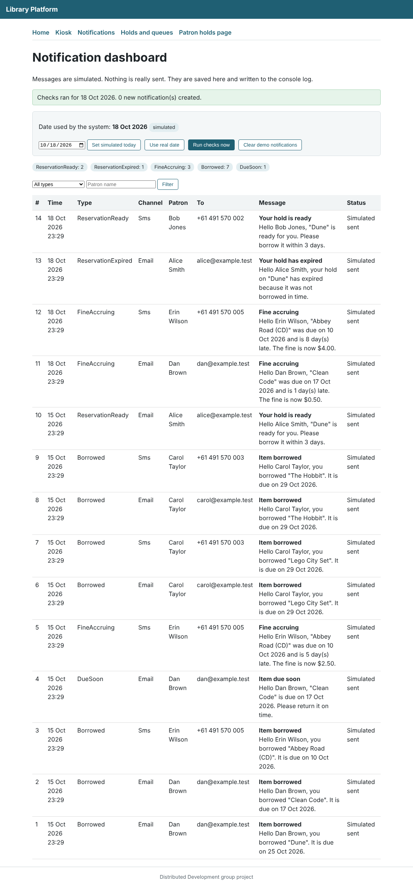

## 7. If something goes wrong

| Message | What to do |
|---|---|
| The card number or PIN is not correct. | Check your card and try again. Ask the desk if you forgot your PIN. |
| We could not find an item with that code. | Check the sticker and type it again. |
| This item is already borrowed. | Place a hold. |
| This item is damaged and cannot be borrowed. | Place a hold, or ask at the desk. |
| This item has been destroyed and cannot be borrowed. | Ask staff. |
| This item belongs to a different branch. | Go to the branch shown for the item. |
| This item is being held for another patron. | Place a hold to join the line. |
| This item is available now, so you can borrow it instead of placing a hold. | Borrow it. |
| You already have a hold on this item. | Nothing to do. |
| You already have this item on loan. | Return it first if you want it again. |
| You have reached the limit of 5 active holds. | Cancel a hold you do not need. |
| That is the most items for one visit. | Take your receipt, then sign in again. |
| That hold could not be found. | It was already cancelled or finished. |

## 8. Need help?

Ask any staff member at the desk.

## Demo data

All demo members use PIN **1234**.

| Card | Name | Messages by | Good for |
|---|---|---|---|
| 1001 | Alice Smith | Email | First in line for "Dune". |
| 1002 | Bob Jones | SMS | Second in line for "Dune". |
| 1003 | Carol Taylor | Email and SMS | Borrowing at the kiosk. |
| 1004 | Dan Brown | Email | Two loans, one due soon. |
| 1005 | Erin Wilson | SMS | One overdue loan with a fine. |

Items: `LIB-0004` and `LIB-0005` are Available. `LIB-0001` to `LIB-0003` are Borrowed. `LIB-0006` is Damaged.
