# Library Platform: User Guide

This guide explains how to use the Library Platform whether you are a visitor, a library member, reception staff, an administrator or a manager.
Every screen shown here comes from the running system with the demo data. Demo sign-ins are listed in section 9.

## 1. Who does what

| You are | You can | Start at |
|---|---|---|
| A visitor (no sign-in) | Search the catalogue from any device, see item details, branch addresses and opening hours | `/` |
| A library member (patron) | Everything above, plus see your loans, fines and holds, place and cancel holds, borrow at a self-service kiosk | `/account` or `/kiosk` |
| Reception staff | Lend and take back items, manage borrowers, place holds for members, move items between branches, record paid fines | `/staff/login` |
| An administrator | Everything reception can do at any branch, plus manage items, branches, categories, staff, imports and the notification simulator | `/staff/login` |
| A manager | See the analytics dashboard and download CSV or PDF reports | `/staff/login` |

Rules that apply everywhere: a loan lasts **14 days**; a late item costs **$0.50 for every full day** after the due date; an item has one library code
(for example `BK-001`) and is held at exactly one branch.

## 2. Searching the catalogue (everyone)

Open the home page. Type part of a title, author, artist or library code, or narrow the list with the type, branch and category menus. Tick
**Show only items available now** to hide borrowed items. Results show the item type, the branch holding it and a coloured status.

Select **Details** for an item. The page shows its details, which branch holds it, whether it is available, how many people are waiting for it, and the
branch address and opening hours.

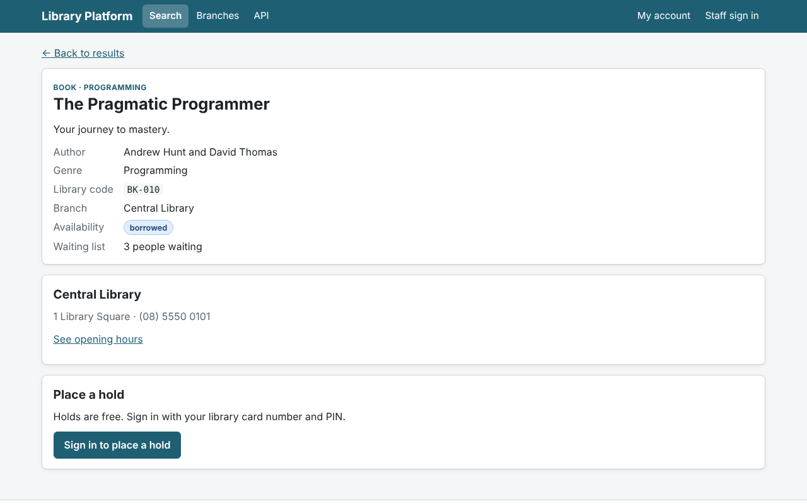

**Statuses.** *available*: on the shelf. *borrowed*: on loan. *damaged*: being repaired and cannot be lent. *in transit*: moving between branches and cannot be
lent. Items that have been destroyed never appear.

### Branches and opening hours

Select **Branches** in the top bar for every branch with its address, phone number, weekly hours and whether it is open now.

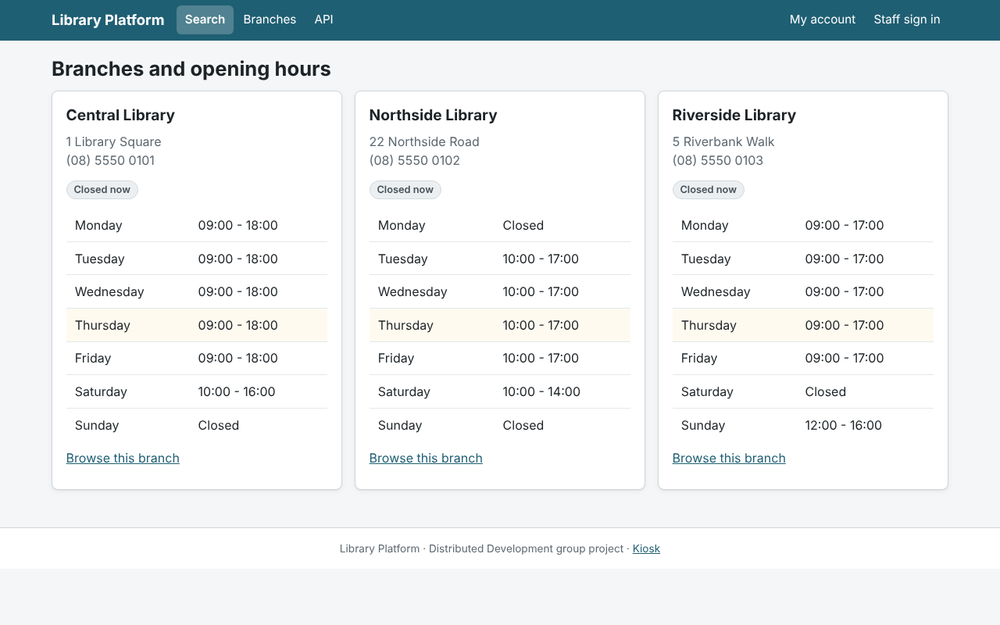

### On a phone

The public pages are built for phones. The menu folds into a **Menu** button, search filters stack, and results are one card per item.

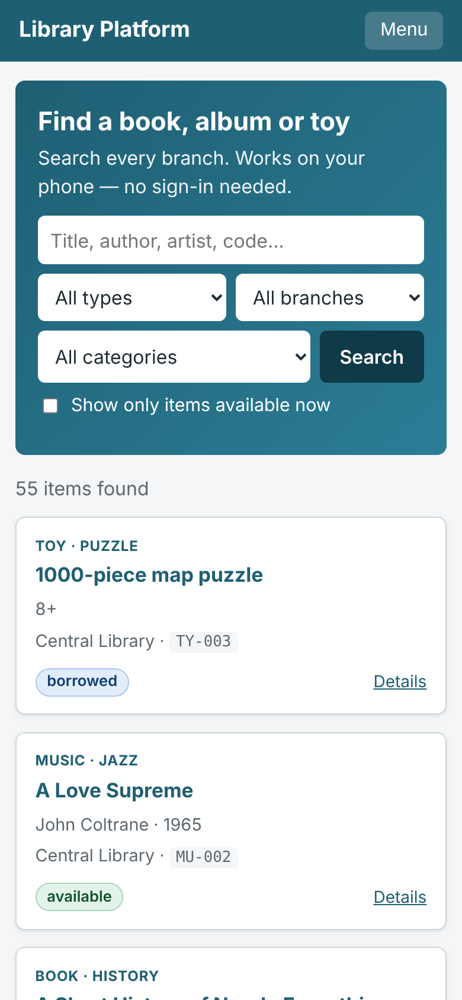

## 3. Members (patrons)

### Your account on the web

Select **My account**, enter your library card number (for example `LIB-1004`) and your four-digit PIN. Your account shows the items you have on loan with
their due dates, any fine, your holds and your recent returns.

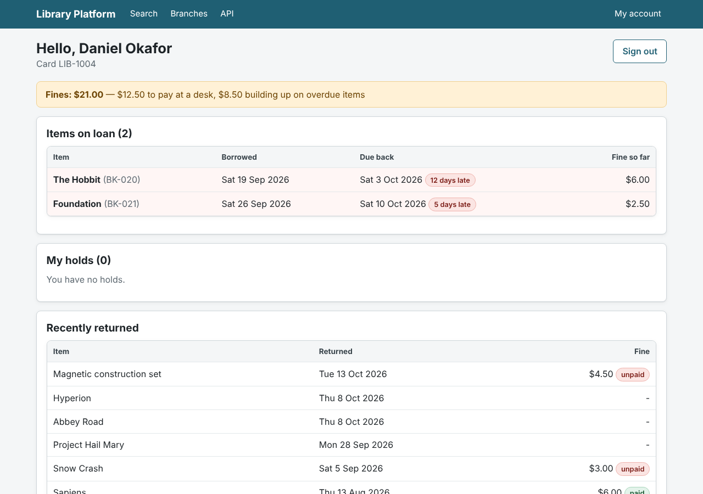

Five wrong PINs in a row lock the card for five minutes; ask reception to reset a forgotten PIN.

### Placing a hold

If an item you want is not available (it is borrowed, damaged or moving between branches), open its page while signed in and select **Place a hold**. An item that is on the shelf cannot be held: borrow it instead. You join the waiting list. When the item comes back and you are first
in line, it becomes **Ready**, you receive a notification, and it is kept for you for three days. Nobody else can borrow it meanwhile. Cancel a hold from **My account** at any time.

### The self-service kiosk

At a kiosk (`/kiosk`) type your card number and PIN on the large keypad and press **Sign in**.

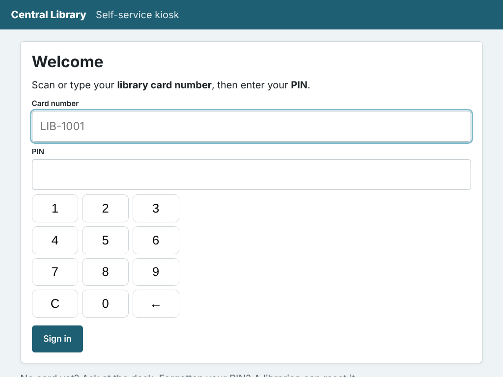

Your account summary lists your loans, holds and fines. A yellow note shows how much you owe.

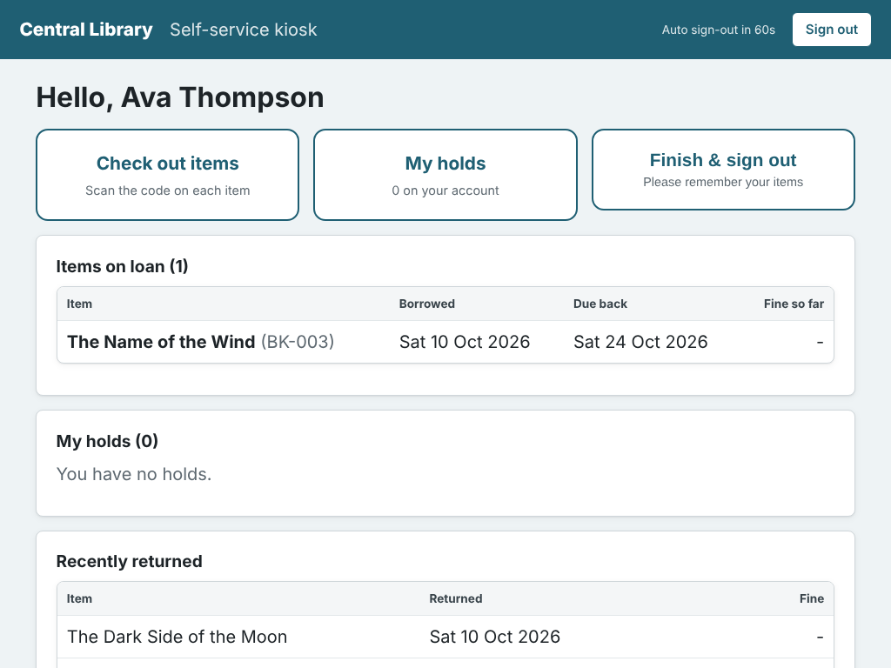

To borrow, press **Check out items**, type or scan the library code on the item and press Enter. Repeat for each item. The screen confirms each item and its due
date. If an item cannot be borrowed (for example it is held for someone else, damaged or no longer in the library) you get a plain message instead.

Press **Done: show my receipt** to see (and print) your receipt, then **Finish & sign out**. The kiosk signs you out by itself after 60 seconds without activity, so
the next person never sees your account.

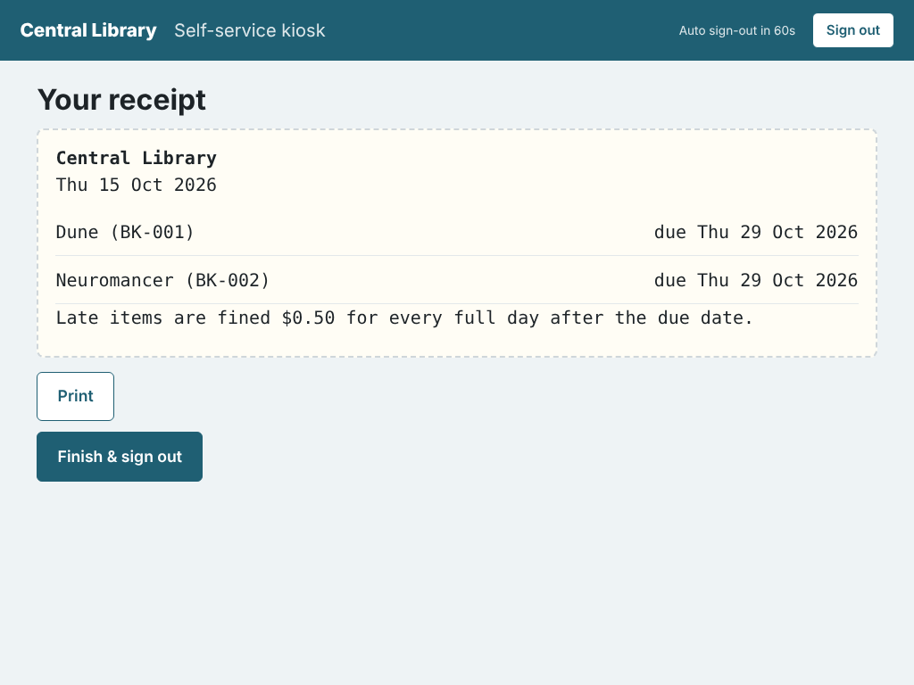

Fines are paid at a desk. The kiosk shows how much is already charged and how much is still building up on overdue items.

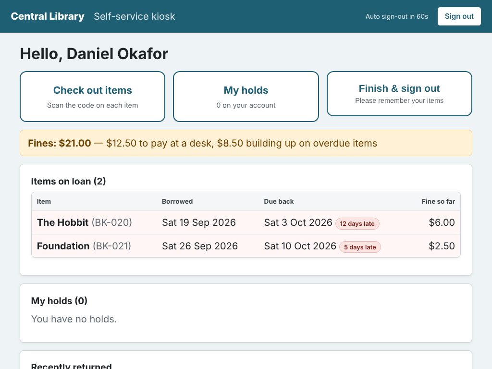

## 4. Reception staff

### Signing in and choosing a branch

Go to `/staff/login` and sign in with your staff name and password.

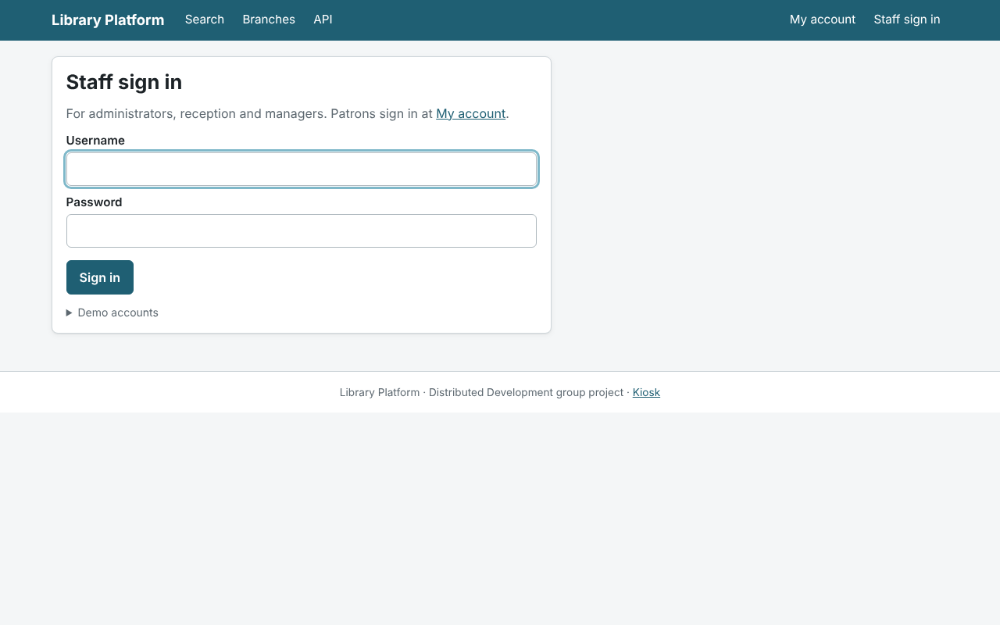

If you work at more than one branch you are asked to choose your **branch** and **reception desk**. Everything you do (lending, returns, transfers) is recorded against that branch and
desk. Change it at any time by selecting the branch name in the top right.

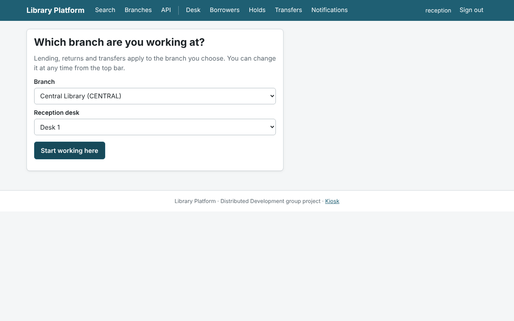

### Lending and taking back (Desk)

Open **Desk**. To lend, type the borrower's card number (or part of their name) and the item's library code, then select **Lend item**. The due date is
shown. To take an item back, type its code and select **Take item back**; tick *It came back damaged* if it is damaged. Fines for late items are
calculated automatically and shown. Items can be returned at any branch: the item then belongs to the branch where it was returned.

Refusals explain themselves: *already borrowed*, *damaged*, *held for another patron*, *in transit* or *not at this branch*.

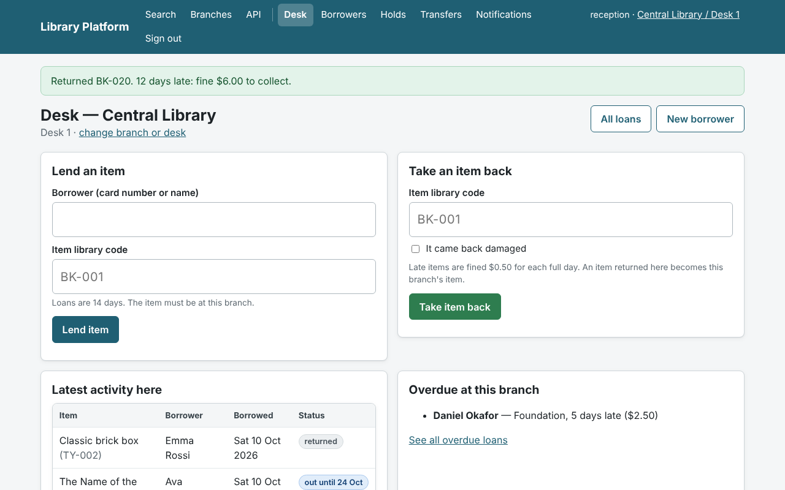

**All loans** lists current and past loans with filters for overdue and unpaid fines. Select **Mark paid** to record that a fine has been collected.

### Borrowers

**Borrowers** lists members with search. Use **Add a borrower** to register someone: they get a library card number and a four-digit PIN, shown **once** on screen, so write it
down for them. **Edit** changes their details and preferred notification channel (email, SMS or both). **Reset PIN** gives a new PIN. A borrower cannot be deleted while items are on loan, or once they have a loan or hold history (the reports rely on it).

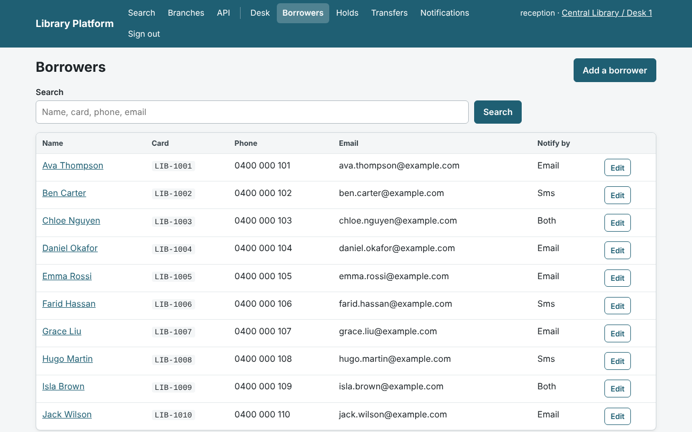

### Holds

**Holds** shows each waiting list, in order. Use **Place hold** to add a member to the list for an item, or **Cancel** to remove one. A **Ready** hold shows when it expires.

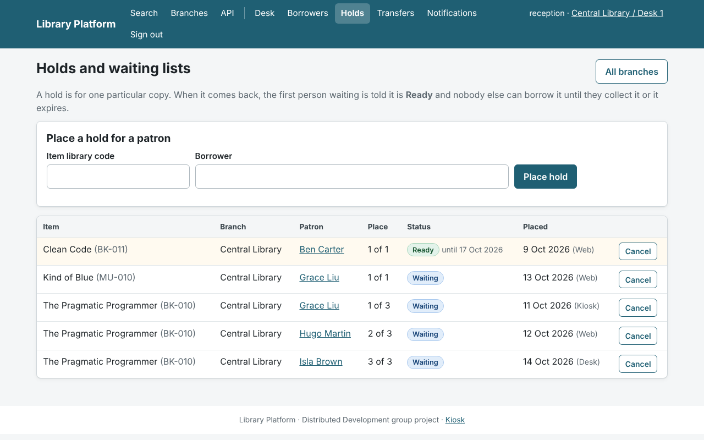

### Transfers between branches

Open **Transfers**. To move an item, type its library code, choose the destination branch and select **Request**. The sending branch selects **Dispatch** when it
leaves; the receiving branch selects **Receive** when it arrives, and only then does the item belong to the new branch. A transfer can be cancelled while it is still *Requested*.
While an item is requested or in transit it cannot be lent.

### Notifications

**Notifications** lists every email and SMS the system has "sent" (the system only simulates sending). Filter by type, channel or search text.

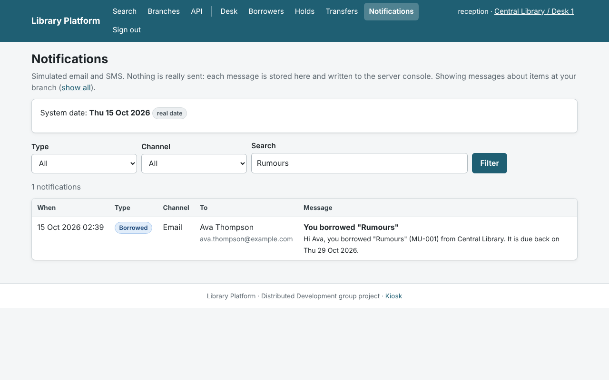

## 5. Administrators

Administrators see extra menu items: **Items**, **Branches**, **Categories**, **Import** and **Staff**.

### Items

**Items** lists the whole catalogue with filters. **Add book / Add music / Add toy** opens a form for a new item (a library code is required and must be unique). **Edit**
changes details. The **Set status** menu changes an item to *available*, *damaged* or *destroy* (an item that is on loan has no menu: take it back first). Setting a damaged item back to available offers it to the first person waiting for it.

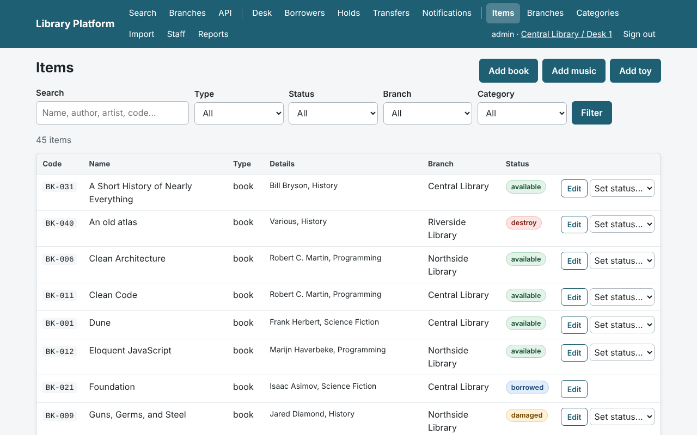

### Branches, categories and staff

**Branches** lets you add a branch, edit its address and weekly opening hours, add desks, and close a branch down. A branch can be deleted only if it has no items and no history. **Categories** manages the
category lists used by search and import. **Staff** adds staff users, resets passwords and chooses which branches a reception user may work at.

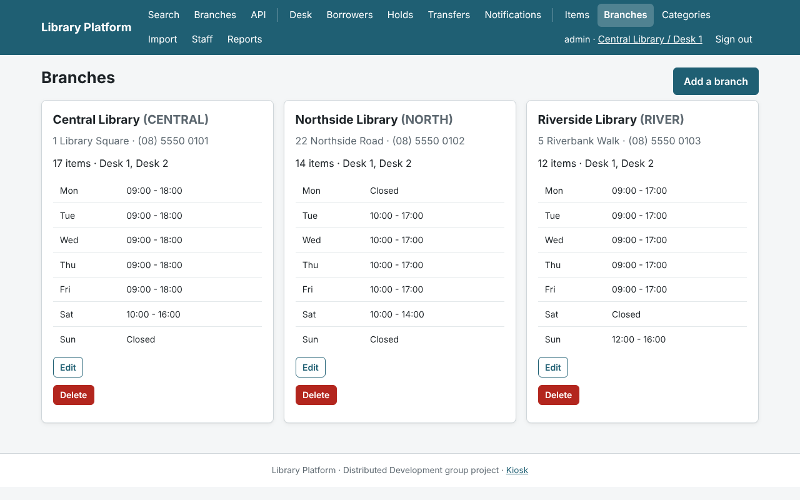

### Importing items

Open **Import**. Choose a CSV file and the branch the items go to, then select **Check the file**. Nothing is saved yet: you see a preview with every row marked *ok* or *skipped* with the reason.

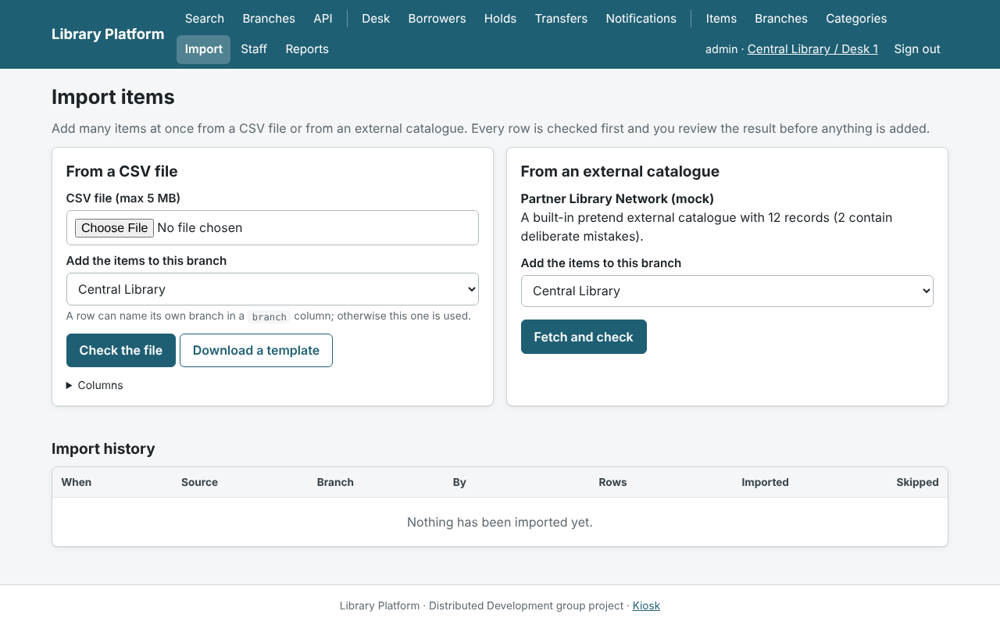

Select **Import valid rows** to save the good rows, or cancel. Skipped rows can be downloaded as a CSV (**Download the problems as CSV**), fixed and uploaded again.
**Download a template** gives a file with the right columns. **Fetch and check** under *external catalogue* loads a ready-made batch from a simulated partner provider through the same preview. The import history at the bottom of the page keeps a record of every run.

### The notification simulator

On **Notifications** administrators can press **Run checks now** to create due-soon notices (items due within 2 days) and overdue-fine notices; running it twice in a day does not repeat notices.
**+1 day** and **+7 days** move the system's "today" forward so that you can see future notices without waiting; **Use real date** puts it back. A banner shows when a simulated date is active.

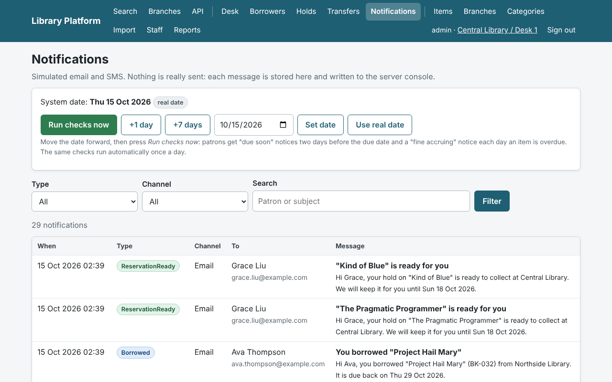

## 6. Managers

Sign in as a manager and you land on the **dashboard**: loans in the last 30 days, items out, overdue items, unpaid fines, and charts of loans by month, type and branch. Choose a
date range and branch and select **Update**.

Three full reports are available. Each can be viewed on screen and downloaded as **CSV** (opens in Excel) or **PDF**:

- **Borrowing statistics:** loans by month, type, category and branch; most borrowed items; on-time rate; kiosk share.
- **Fine revenue:** fines charged, collected and outstanding by month and branch, and who owes what.
- **Inventory health:** stock by branch and status, idle items (not borrowed for 90 days), damaged items, transfers and the items people are waiting for.

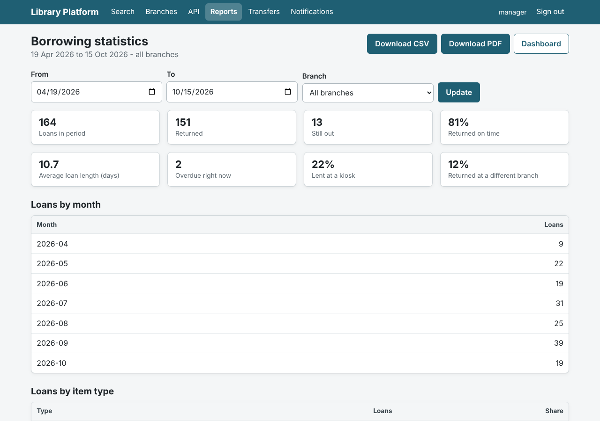

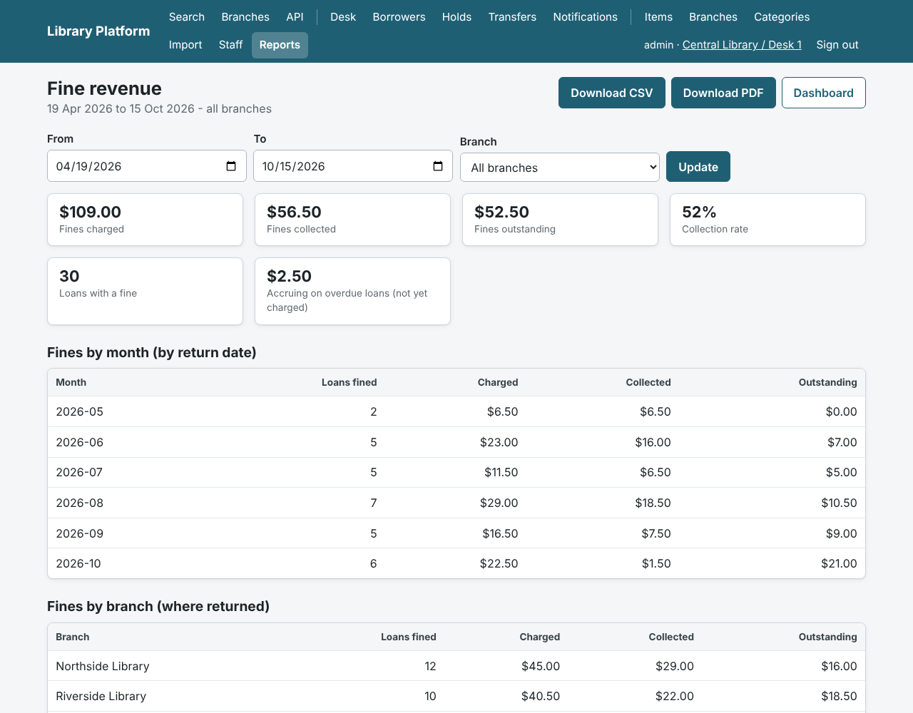

## 7. For developers: the public API

Other systems can read the catalogue at `/api/v1/...` with the header `X-Api-Key`. See `/api/docs` for an interactive page where you can try each request.

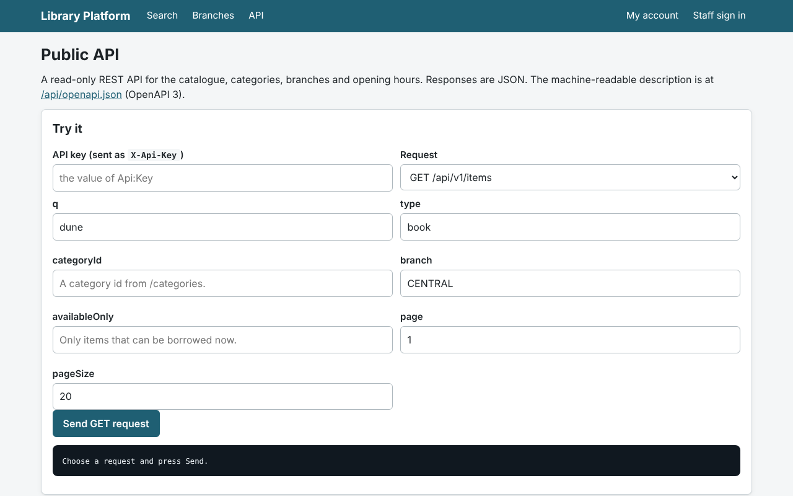

## 8. Questions and problems

| Question | Answer |
|---|---|
| I forgot my PIN | Ask reception to **Reset PIN** on your borrower record. |
| My card is locked | Wait five minutes, or ask reception to reset the PIN. |
| The kiosk signed me out | It does after 60 seconds of no activity. Sign in again. |
| An item will not lend | Read the message. Usual reasons: already borrowed, damaged, held for someone else, in transit, or at a different branch. |
| Why has a fine appeared? | $0.50 for each full day after the due date. Pay at a desk; reception marks it paid. |
| I can't see Reports | Reports are for managers and administrators. |
| An item I imported is not visible | Check the preview: skipped rows are not imported. Imported items are visible straight away in search. |
| The page looks wrong on my phone | Reload. The public pages work on phone-size screens; staff pages are best on a tablet or computer. |

## 9. Demo sign-ins

| Who | Username / card | Password / PIN |
|---|---|---|
| Admin | `admin` | `admin123` |
| Reception, Central and Northside | `reception` | `reception123` |
| Reception, Riverside | `reception.river` | `reception123` |
| Manager | `manager` | `manager123` |
| Members | `LIB-1001` to `LIB-1010` | `1111`, `2222`, ... `9999`, `0000` |
| API key | | `demo-api-key-2026` |
