# Group Portfolio

This portfolio collects the project-management artefacts, the integration diagrams and the user journey maps for the Library Platform, with the evidence that
the integrated product works.

| Team member | Student ID |
|---|---|
| Mohammed Nurul Hasan | S376146 |
| Md Rakibul Hassan Emon | S375332 |
| Md Modasser Hossain | S375173 |

The code, README and guides are in the repository <https://github.com/nurulhasan2k/library-platform.git>.

## 1. Project at a glance

The client asked for the Assignment 2 library system to be expanded into **one coherent platform** rather than seven prototypes. The result is a single .NET 10 ASP.NET Core MVC
application in which a patron can search from a phone, borrow at a kiosk or a desk, join a waiting list, be notified; staff can move items between branches and import
stock; and managers can see and export reports, all from the same data.

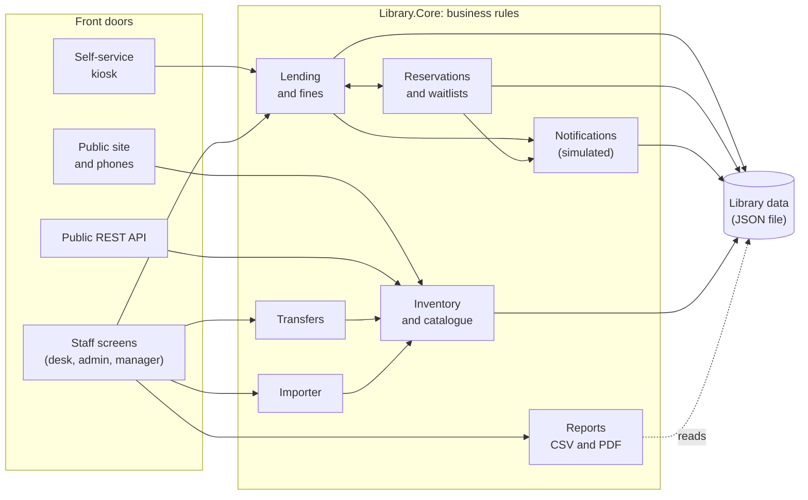

## 2. Project-management artefacts

### 2.1 Phases and what each produced

| Phase | Focus | Result |
|---|---|---|
| 0 Kickoff | Agree the contract and split the work | Repository with standards and PR template; service contracts and stubs; ER diagram; seed scenarios; 14 design decisions; project board with 68 cards |
| 1 Foundation | Stabilise the baseline and the multi-branch data model | Assignment 2 rules ported to .NET 10 MVC; roles and sign-in; branches, desks, categories; branch-aware lending; core seed data |
| 2 Features | Build the seven features in parallel | Kiosk, API, notifications, transfers, reservations, importer, analytics |
| 3 Integration | Connect everything and run the demo list | Seven integration chains tested end to end; 12 demo items checked |
| 4 Documentation | Guides and evidence | README (14 topics), installation guide, user guide, plan, portfolio |

### 2.2 Ownership (who is responsible and who supplies)

R = responsible (leads), S = supplies a part, V = reviews.

| Area | Mohammed Nurul Hasan | Md Rakibul Hassan Emon | Md Modasser Hossain |
|---|---|---|---|
| Foundation: MVC port, data, roles, layout | R | V | S |
| 3.4 Multi-branch inventory and transfers | R | S | S (report) |
| 3.1 Self-service kiosk | S (lending) | R | V |
| 3.3 Notifications | S (hooks) | R | S (counts for reports) |
| 3.5 Reservations and waitlists | S (status hooks) | R | V |
| 3.2 Public REST API | S (data) | V | R |
| 3.6 Data importer | S (branches, rules) | V | R |
| 3.7 Manager analytics and export | S (roles, history) | S (queue counts) | R |
| Seed and reset | R | S | S |
| README, Installation guide | R | S | S |
| User Guide, Project Plan | V | R | S |
| Group Portfolio | S | S | R |
| Code review rotation | reviews Rakibul | reviews Modasser | reviews Mohammed |

### 2.3 Work packages

68 tasks on the project board, each with an owner, a milestone and an estimate. Totals by milestone (estimated hours):

| Team member | Kickoff | Midpoint | Final | Total |
|---|---|---|---|---|
| Mohammed Nurul Hasan | 7 | 78 | 40 | 125 |
| Md Rakibul Hassan Emon | 6 | 59 | 64 | 129 |
| Md Modasser Hossain | 4 | 63 | 70 | 137 |
| Team | 17 | 200 | 174 | 391 |

The full task list is Appendix A of the Project Plan.

### 2.4 Risk register

| # | Risk | Likelihood | Impact | Mitigation | Outcome |
|---|---|---|---|---|---|
| R1 | Three people build incompatible parts | High | High | Contract-first: interfaces, data model, roles matrix and seed data agreed before building; stubs so everything compiles | Contracts kept; stubs replaced by real services |
| R2 | The integrated demo does not work on the assessor's virtual machine | Medium | High | No external packages, no database server, one command to run and one to reset; installation guide with troubleshooting; scripted fresh-install check | Fresh clone builds and runs; VM image itself still to be checked |
| R3 | NuGet or internet is not available on the VM | Medium | High | Use only what ships with the .NET 10 SDK | Zero third-party packages |
| R4 | Meaning of "branch" is ambiguous | Medium | Medium | Assume library branch; state it in README and decisions; ask the client | Assumption documented |
| R5 | Time runs short (the three planned meetings were not held) | High | Medium | Decisions recorded in writing; shared project board; automated tests keep integration honest | Decisions in `docs/DECISIONS.md`; all features completed |
| R6 | Demonstrating time-based notifications takes days | Medium | Medium | Admin "simulated today" and "Run checks now" using the same code as the daily job | Demonstrable in a minute |
| R7 | Imported data corrupts the catalogue | Medium | High | Validate every row, preview before saving, re-check at commit, import history, problems file | 12 importer tests; sample files for every rule |
| R8 | Reports disagree between screen and exports | Medium | Medium | One report document builds the dashboard, the CSV and the PDF | Tested: dashboard figures equal the reports |
| R9 | Public API exposes private data or is abused | Low | High | Read-only (405 otherwise), key, rate limit, DTOs without patron or loan data | Tested by API checks |
| R10 | Demo data goes stale | Medium | Medium | Seeded dates are relative to today; `--reset-db` | Reset tested |

### 2.5 Tools and communication

GitHub repository and GitHub Projects board for tasks; pull requests with a template and one reviewer each; a team chat with a twice-weekly written check-in; `docs/DECISIONS.md`
as the decision log; the automated tests and the scripted browser run as the quality gate.

### 2.6 Decision log (summary)

| # | Decision | Chosen |
|---|---|---|
| D1 | Data storage | One JSON file behind a storage interface (nothing to install; easy reset) |
| D2 | Authentication | Cookie authentication, three schemes (staff, patron, kiosk), roles Admin / Reception / Manager |
| D3 | Patron identity | Card number + 4-digit PIN, hashed, lock-out after 5 wrong tries |
| D4 | Reservation granularity | Per physical copy |
| D5, D6 | Where an item is, in transit | The branch holding it; "in transit" derived from an active transfer |
| D9, D10 | Notifications and time | Simulated email/SMS; admin simulated date and "Run checks now" |
| D11, D12 | CSV, PDF, API docs | Hand-written writers and OpenAPI document (no packages) |
| D13 | API protection | Read-only, API key, rate limit |

The full list with reasons and trade-offs is in `docs/DECISIONS.md`.

## 3. System diagrams

### 3.1 Data model

The data model (full diagram in `docs/ER-DIAGRAM.md`):

### 3.2 Item status and transfer life cycle

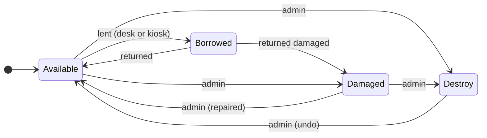

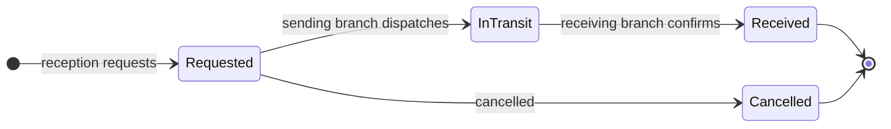

While a transfer is *Requested* or *InTransit* the item cannot be lent. The item changes branch only when the transfer is *Received*.

### 3.3 Reservation life cycle

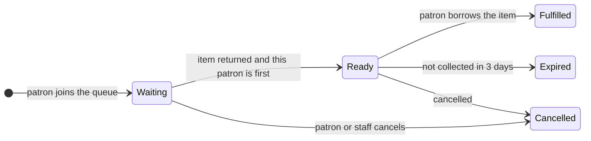

## 4. Integration diagrams: the seven workflows

Each diagram shows the real calls between parts of the system.

### Chain 1. A patron borrows an item, the inventory is updated, a notification is recorded

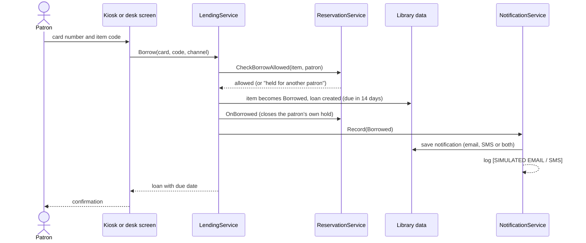

### Chain 2. An item is unavailable and a patron joins its waitlist

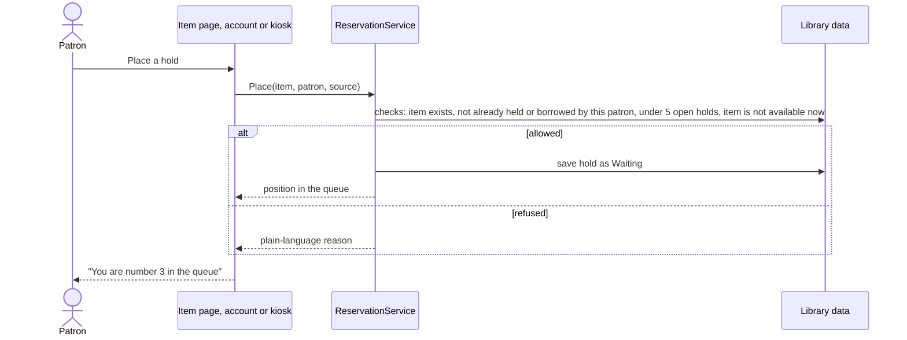

### Chain 3. An item becomes available and the next patron is notified

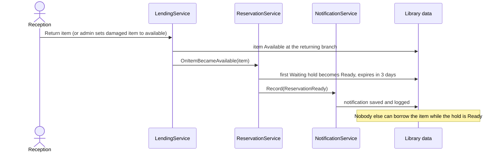

### Chain 4. An administrator imports items and they appear in the catalogue

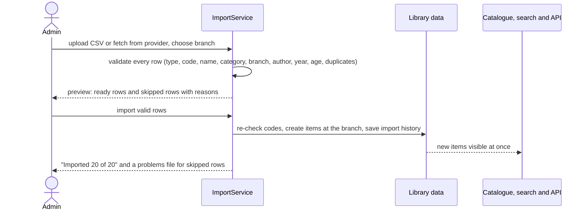

### Chain 5. A manager views reports and exports them

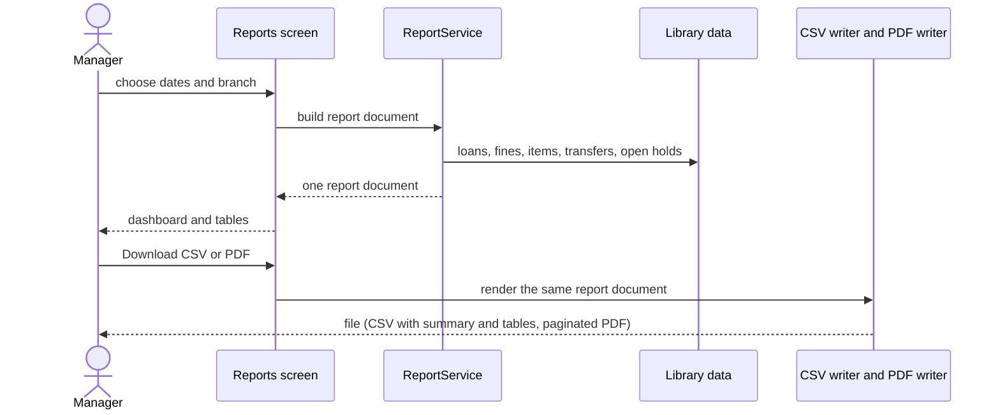

### Chain 6. An external client queries the catalogue through the API

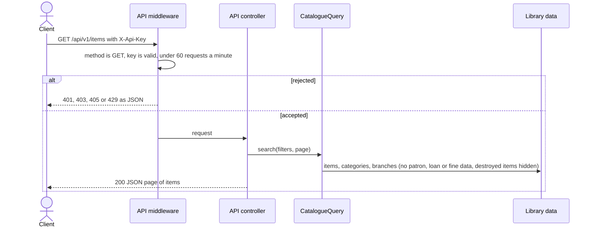

### Chain 7. Staff identify item branches and coordinate transfers

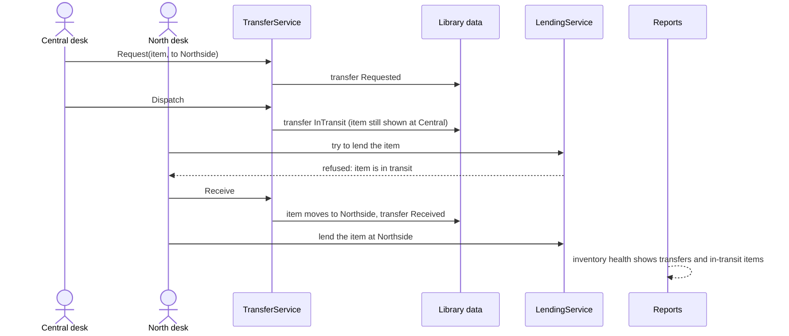

## 5. User journey maps

Scores run from 1 (frustrating) to 5 (delightful). Each map is followed by what the system does to remove the pain points.

### Journey 1. Ava borrows at the self-service kiosk

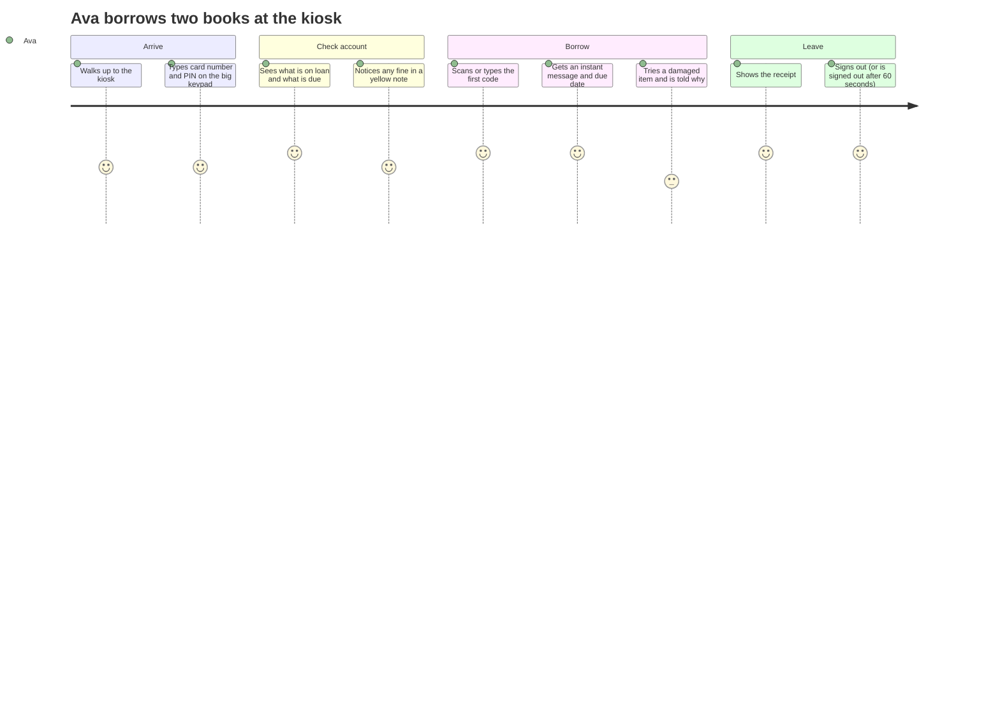

| Stage | Pain point | What the system does |
|---|---|---|
| Arrive | Typing a PIN in public | PIN keypad, masked input, five wrong tries lock the card for five minutes |
| Borrow | Not knowing why an item was refused | Plain message: damaged, held for someone else, in transit, not at this branch |
| Leave | Forgetting to sign out | Auto sign-out after 60 idle seconds so the next person never sees the account |

### Journey 2. Grace waits for a book and is told when it is ready

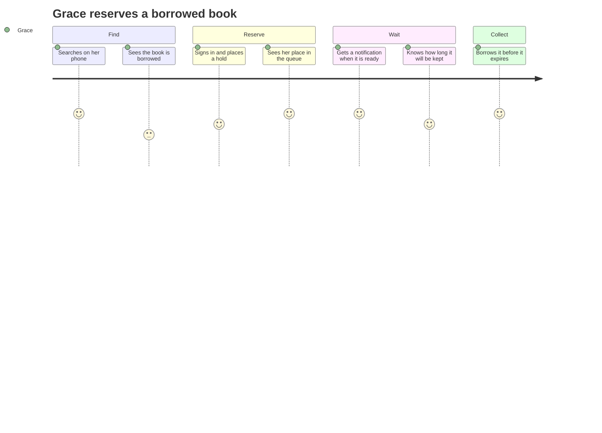

| Stage | Pain point | What the system does |
|---|---|---|
| Find | Not knowing if it will ever be free | Item page shows status and how many are waiting |
| Wait | Missing the call | Email, SMS or both according to her preference; item kept for three days |
| Collect | Someone else taking it | While a hold is Ready nobody else can borrow the item |

### Journey 3. Reception moves a book to another branch

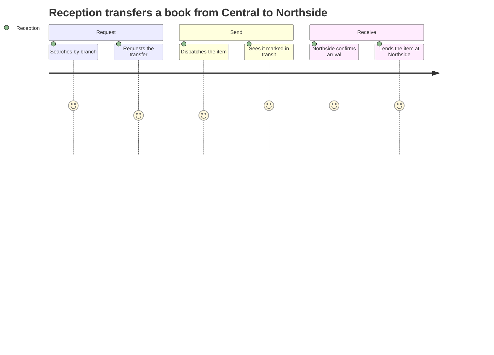

| Stage | Pain point | What the system does |
|---|---|---|
| Send | Item lent while on a truck | In-transit items cannot be lent |
| Receive | Nobody knows where it is | Item changes branch only when the receiving branch confirms; both branches see the same state |

### Journey 4. An administrator imports new stock

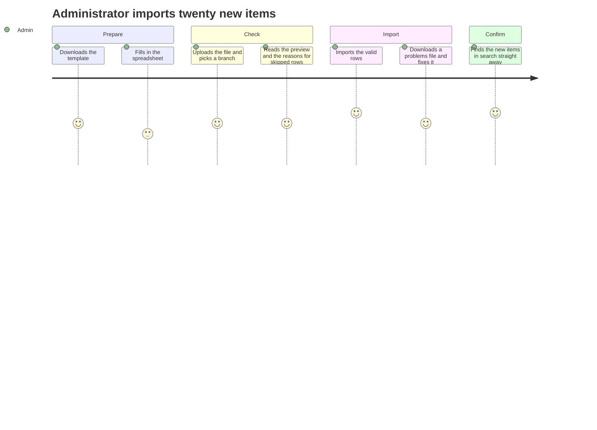

| Stage | Pain point | What the system does |
|---|---|---|
| Check | Bad data silently entering the catalogue | Every row validated; nothing saved until the admin confirms |
| Import | Having to guess what is wrong | Each skipped row has a plain reason; problems can be downloaded as a CSV and fixed |

### Journey 5. A manager reviews performance and exports

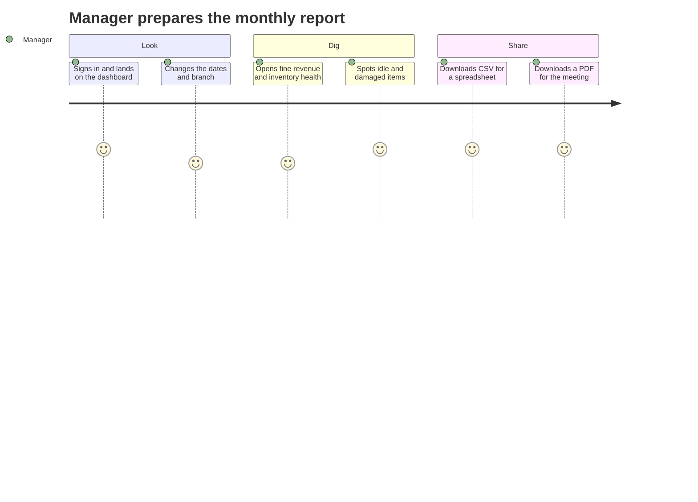

| Stage | Pain point | What the system does |
|---|---|---|
| Dig | Numbers differ between screen and file | The screen, CSV and PDF are produced from the same report |
| Share | A PDF that is hard to read | Paginated PDF with title, filters, headings and "Page n of N" |

### Journey 6. A developer uses the public API

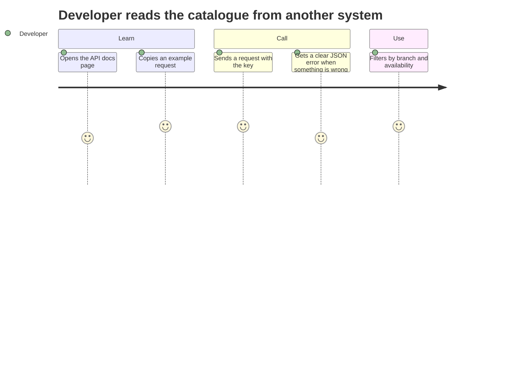

| Stage | Pain point | What the system does |
|---|---|---|
| Learn | Guessing the parameters | Interactive docs page, OpenAPI document, `curl` and `.http` examples |
| Call | Unclear errors | 401, 403, 404, 405, 429 each return a JSON error with a code and message |

## 6. Requirements traceability

| Client requirement | Where it is built | Evidence |
|---|---|---|
| 3.1 Kiosk: sign in, account summary, checkout, receipt, timeout | Kiosk controller and views; `PatronAuthService`; `LendingService` | Demo item 3 (9 browser checks); 7 sign-in tests |
| 3.2 Public read-only API with key, limits and docs | `/api/v1`, API middleware, rate limiter, OpenAPI document, docs page | Demo item 4 (10 checks); 10 catalogue tests; 429 verified |
| 3.3 Notifications (email and SMS simulated, preference, due soon, fines, reservation) | `NotificationService`, scheduler, notifications page | Demo items 5 and 6; 7 notification tests |
| 3.4 Multi-branch inventory and transfers | Branch on every item, staff branch context, `TransferService`, transfer screens | Demo items 2 and 7; 7 transfer tests |
| 3.5 Reservations and waitlists | `ReservationService`, holds screens, account and kiosk | Demo item 8 (7 checks); 10 reservation tests |
| 3.6 Data importer | `ImportService`, CSV reader, mock provider, preview and history | Demo item 9 (5 checks); 12 importer tests including the sample files |
| 3.7 Analytics and CSV and PDF export | `ReportService`, `CsvExporter`, `PdfReportWriter`, dashboard | Demo items 10 and 11 (12 checks); 12 report tests |
| 4 The seven integration workflows | Hooks between lending, reservations and notifications; shared catalogue; shared report document | Section 4 diagrams; demo items 3, 5, 7, 8, 9 |
| 6 Seed and reset | `SeedRunner`, `--reset-db` | Demo item 12; 13 seed tests; reset run verified |
| Baseline Assignment 2 rules (14-day loan, $0.50 per full late day, borrower and item CRUD, roles, public search) | Lending, inventory and borrower services | 20 lending tests, 13 admin tests, 6 borrower tests |
| Mobile-responsive public portal | Responsive stylesheet | Phone-size checks: no sideways scrolling |
| Validation and useful errors | Server-side validation; plain-language messages | Importer and lending tests; friendly error pages |
| Admin tools not public | `[Authorize(Roles = ...)]` on every staff controller | Demo item 12 check; manager refused on admin pages |

## 7. Test evidence

### 7.1 Automated tests (117 passed, 0 failed)

| Area | Tests |
|---|---|
| Demo data | 13 |
| Items, categories and branches | 13 |
| Borrowers and staff | 6 |
| Lending and returning | 20 |
| Inter-branch transfers | 7 |
| Reservations and waitlists | 10 |
| Notifications | 7 |
| Patron sign-in | 7 |
| Catalogue queries | 10 |
| Data importer | 12 |
| Manager analytics and exports | 12 |

### 7.2 Scripted browser run of the 12 demo items (67 checks passed, 0 failed)

| Demo item | Checks | Result |
|---|---|---|
| 1 Fresh install and startup | 3 | Pass |
| 2 Selecting a branch | 3 | Pass |
| 3 Kiosk checkout and account summary | 9 | Pass |
| 4 Public API requests | 10 | Pass |
| 5 Borrowing and notification logging | 2 (plus kiosk loans in item 3) | Pass |
| 6 Due-date and fine notification simulation | 5 | Pass |
| 7 Multi-branch inventory and transfer | 8 | Pass |
| 8 Reservation and next-person notification | 7 | Pass |
| 9 CSV or external import | 5 | Pass |
| 10 and 11 Manager analytics and exports | 12 | Pass |
| 12 Seeding and reset | 13 seed tests; `--reset-db --exit` run | Pass |
| Access control and mobile layout | 3 | Pass |

### 7.3 Other checks

- Fresh copy of the repository with an empty data folder: builds with no package download, creates the demo data on first start, serves the site and the API.
- Release build published and run from the publish folder: pages, stylesheet and API work.
- API rate limit: the 61st request in a minute returns 429 with a `Retry-After` header.
- PDF exports rendered to images and read page by page; CSV exports open with a byte-order mark and neutralise formula characters.

*Where this was run:* a clean Linux environment with the .NET 10 SDK and a headless Chromium browser. It has not yet been run on the assessor's own virtual machine image.

## 8. Screens

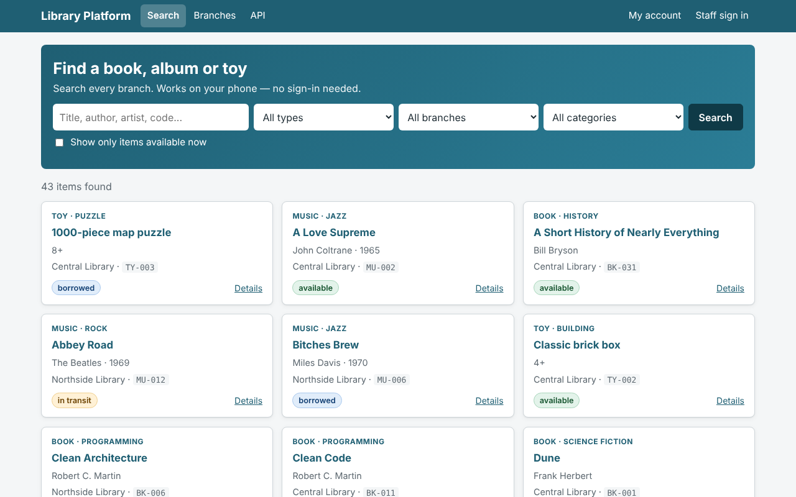

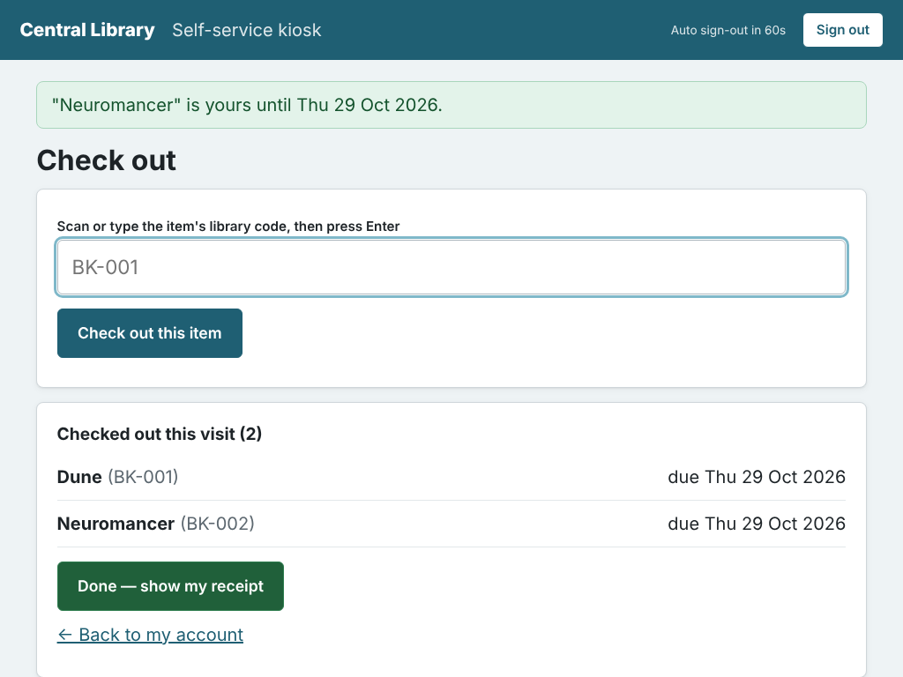

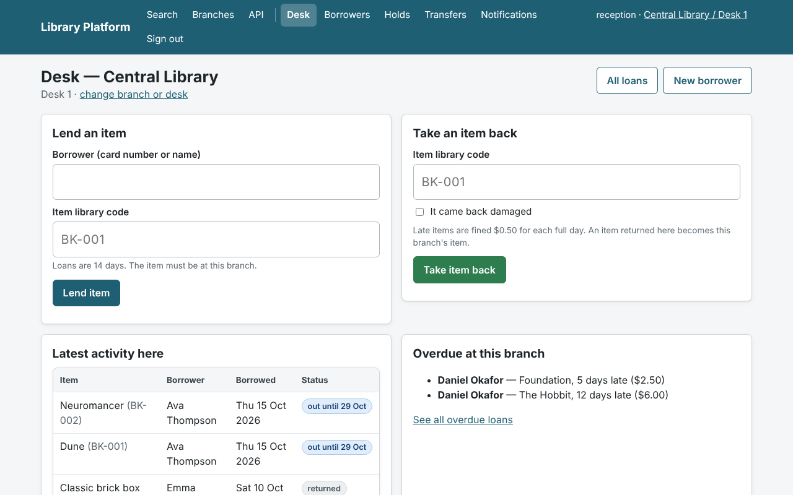

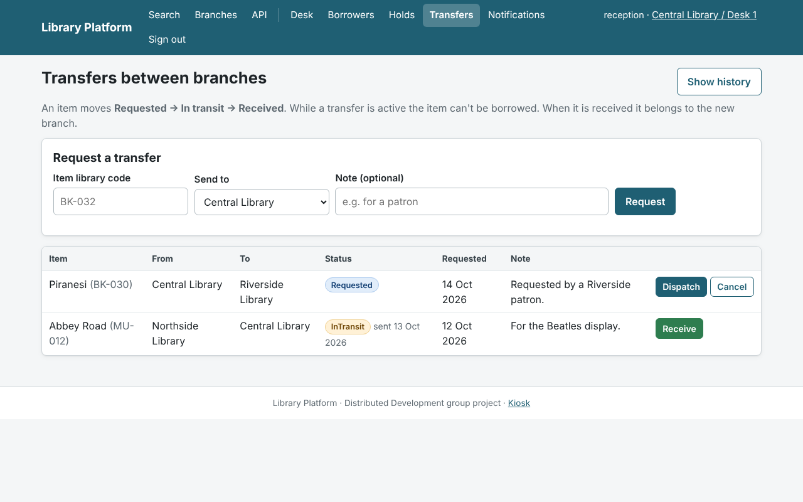

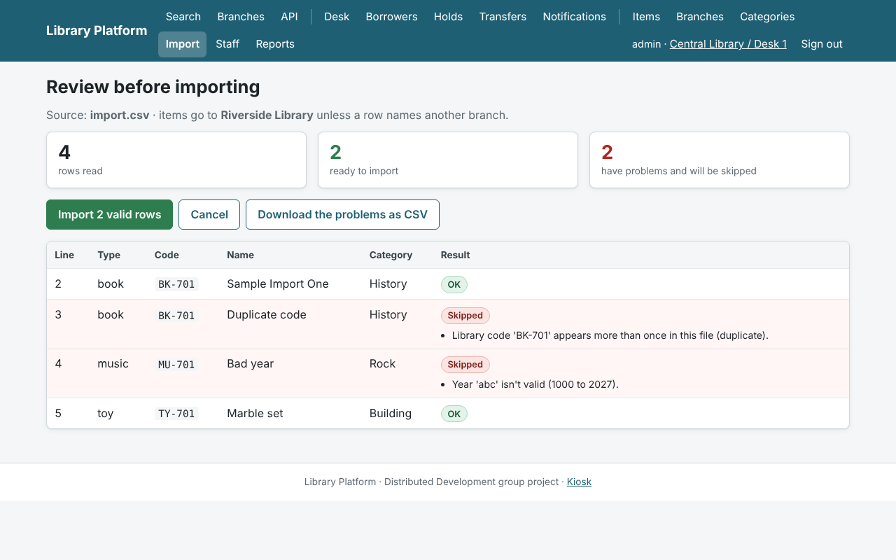

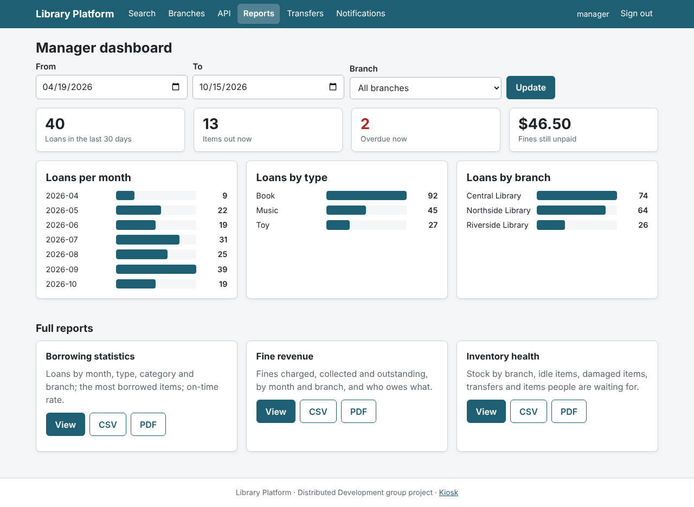

## 9. Known limitations

- JSON file storage suits a demo-sized library, not a very large one.
- Notifications are simulated; nothing is sent. The daily check runs once a day, or when an administrator presses the button.
- One shared demo API key; the site runs on plain HTTP for the demo.
- Holds are per copy, not per title.
- Fines are recorded and reported but there is no payment gateway.
- Tested on Linux in a clean environment; to be re-run on the assessor's virtual machine.
